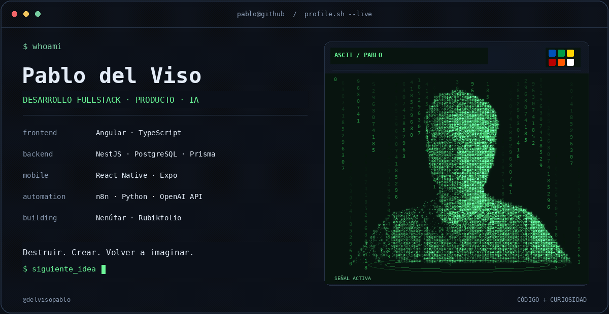

<div align="center">



### Código, ideas y unas cuantas piezas por encajar.


[Portfolio](https://pablodelviso.com) · [LinkedIn](https://linkedin.com/in/pablodelvisogomez) · [Hablemos](mailto:delvisogomezpablo@gmail.com) · [Repositorios](https://github.com/delvisopablo?tab=repositories)

</div>

---

## Hola, soy Pablo 👋

Me gusta convertir ideas en cosas que se puedan usar. Mi formación en **ADE Tecnológico e Ingeniería Informática** me permite moverme entre producto, negocio y desarrollo: entender un problema, plantear una solución y construirla de principio a fin.

- Desarrollo productos propios como **Nenúfar**, **Brocabulario** o **BatToken**.
- Me divierte crear interfaces con personalidad: desde un portfolio construido alrededor de un **cubo de Rubik** hasta una web deliberadamente absurda llena de minijuegos.
- Trabajo con **IA y automatización**, conectando APIs, n8n, email, datos y procesos.
- Desarrollo tanto frontend como backend, bases de datos, autenticación, integraciones y despliegue.
- También experimento con **blockchain, NFC, ESP32 y Raspberry Pi** cuando una idea necesita salir del navegador.
- Fuera del código: cine, series, videojuegos, ajedrez y cacharrear con cualquier cosa que tenga botones.

## Mi caja de herramientas

<div align="center">


</div>

| Área | Tecnologías y herramientas |
| :--- | :--- |
| **Frontend y móvil** | Next.js · React · Angular · TypeScript · React Native · Expo |
| **Backend y datos** | Node.js · NestJS · Express · PostgreSQL · Prisma · Drizzle · API REST · JWT |
| **IA y automatización** | OpenAI API · n8n · Python · Webhooks · Integración de APIs |
| **Interfaces y movimiento** | Figma · Anime.js · Three.js · GSAP |
| **Entrega e infraestructura** | Git · GitHub · Vercel · Railway · Docker · Postman |
| **Web3 y hardware** | Solidity · Hardhat · Ethereum Sepolia · ethers.js · NFC · ESP32 · Raspberry Pi |

## Proyectos con los que voy encajando piezas

| Proyecto | Qué es | Algunas piezas |
| :--- | :--- | :--- |
| [**Nenúfar**](https://nenufar.vercel.app/) | Plataforma para descubrir negocios locales mediante reseñas, comunidad y gamificación. Un proyecto donde producto, tecnología y modelo de negocio tienen que funcionar juntos. | Angular · NestJS · PostgreSQL · Producto |
| [**Rubikfolio**](https://pablodelviso.com/) | Mi portfolio convertido en un cubo de Rubik interactivo. Cada una de sus 54 casillas abre una experiencia diferente sobre proyectos, tecnología, negocio, intereses y mi forma de trabajar. | Next.js · React · Anime.js · Interacción 3D |
| [**PokeListillos**](https://pokelistillos.xyz/) | Proyecto alrededor del universo Pokémon con Pokédex, juegos, rankings e interacción con datos de la PokéAPI. | Angular · TypeScript · APIs · Gamificación |
| [**Brocabulario**](https://brocabulario.es/) | Diccionario colaborativo de jerga y cultura de internet en español, con palabras, propuestas, perfiles, grupos, historias y contenido conectado entre sí. | Next.js · React · PostgreSQL · Drizzle |
| [**BatToken**](https://battoken.vercel.app/) | Sistema de recompensas para incentivar el reciclaje de baterías. Los depósitos validados generan tokens BTT mediante un smart contract desplegado en Ethereum Sepolia. | Angular · Express · PostgreSQL · Solidity · Hardhat · ethers.js |
| [**PutaMierda**](https://putamierda.es/) | Un laboratorio web deliberadamente absurdo para perder el tiempo: Chooser, minijuegos, experimentos de interfaz y un montón de decisiones de diseño cuestionables tomadas a propósito. | Minijuegos web · Interacción · Diseño experimental |
| [**Cumpleaños.digital**](https://cumpleanos.digital/) | Demo de un servicio para crear experiencias de cumpleaños digitales, con personalización, configurador y una gincana interactiva. | React · TypeScript · Vite · Tailwind · Leaflet |
| **Casita** | Aplicación móvil en desarrollo para registrar presencia familiar mediante NFC y conectar el mundo físico con una app y un backend propio. | React Native · Expo · NestJS · PostgreSQL · NFC |

<sub>Algunos proyectos tienen el código público y otros mantienen el repositorio privado. Cuando existe una versión desplegada, el enlace lleva directamente al proyecto para poder probarlo.</sub>

## No me interesa solo que funcione

Me gusta trabajar en la intersección entre **tecnología, producto y negocio**.

```text
Entender el problema
        ↓
Reducirlo a lo importante
        ↓
Diseñar una solución
        ↓
Construirla
        ↓
Probarla
        ↓
Romper alguna cosa
        ↓
Arreglarla
        ↓
Publicarla
        ↓
Volver a mejorarla
```

Me interesa tanto cómo funciona una aplicación como **por qué alguien querría utilizarla**.

Por eso suelo acabar tocando varias capas del mismo proyecto: interfaz, backend, datos, experiencia de usuario, automatizaciones, infraestructura y, cuando hace falta, incluso hardware.

## Ahora mismo estoy construyendo

Siempre tengo alguna cosa a medio cocinar.

Algunas empiezan como una idea de negocio.  
Otras porque quiero aprender una tecnología.  
Y otras simplemente porque pienso: **“esto estaría guapo si existiese”**.

Puedes encontrarlas en [**pablodelviso.com**](https://pablodelviso.com/).

---

<div align="center">

### ¿Tienes una idea que merece salir del bloc de notas?

Puedo ayudarte a convertirla en una **landing, una web, una aplicación, una automatización o un producto digital completo**.

**[Ver mi portfolio](https://pablodelviso.com/) · [LinkedIn](https://linkedin.com/in/pablodelvisogomez) · [delvisogomezpablo@gmail.com](mailto:delvisogomezpablo@gmail.com)**

<sub>Hecho con curiosidad y unas cuantas piezas todavía por encajar.</sub>

</div>

<!-- Inspiración de formato: https://github.com/emmi-lili/emmi-lili.
     Textos y gráficos originales para Pablo del Viso. -->
